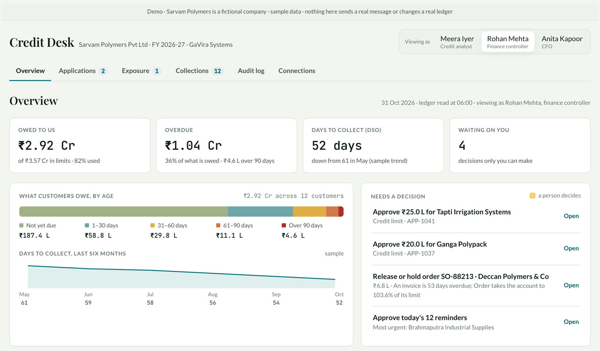
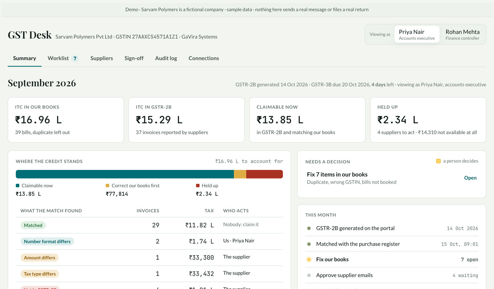
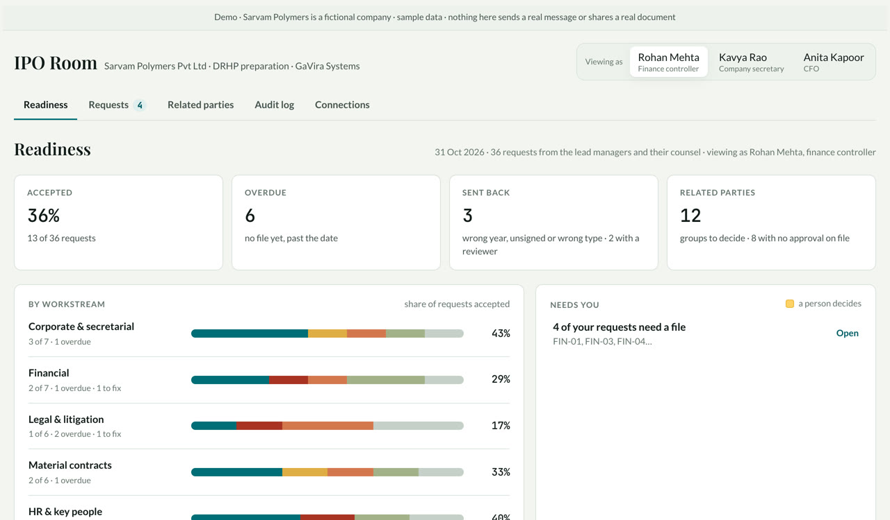
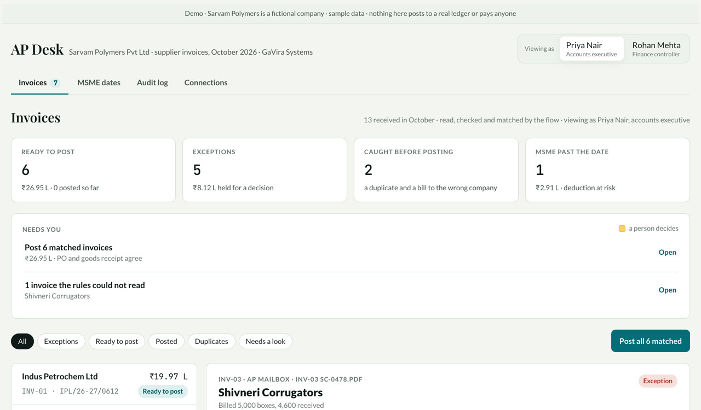

# GaVira Systems: finance demos

**[Live demo → gavira-systems.github.io/gavira-finance-demos](https://gavira-systems.github.io/gavira-finance-demos/)**

Each desk also has a short film, about 80 seconds, that walks through one real example. On the live page, **Watch the film** plays it,
and **Watch all four films** plays all four back to back (5 minutes). The film files are in [`films/`](films/).

Four finance systems you can click through, all running on one fictional company, Sarvam Polymers, with sample data.
Switch people at the top right of any desk to see who can approve what. Nothing here sends a real message or touches a real ledger.

| | Desk | What it does | Who decides |
| --- | --- | --- | --- |
|  | **[Credit Desk](https://gavira-systems.github.io/gavira-finance-demos/credit-desk/)** | Credit applications, limits set by policy, order release checks, daily collections | Finance controller up to ₹50 L, the CFO above that |
|  | **[GST Desk](https://gavira-systems.github.io/gavira-finance-demos/gst-desk/)** | The purchase register matched with GSTR-2B, a worklist for our side, supplier emails, a signed ITC figure | Accounts executive prepares, finance controller signs |
|  | **[IPO Room](https://gavira-systems.github.io/gavira-finance-demos/ipo-room/)** | DRHP requests with owners and dates, every upload checked on arrival, a weekly related-party scan | The company secretary; nobody accepts their own upload |
|  | **[AP Desk](https://gavira-systems.github.io/gavira-finance-demos/ap-desk/)** | Supplier invoices matched with the PO and goods receipt, duplicates caught, MSME dates tracked | Finance controller, with a reason on record |

The same idea runs through all four: the AI reads and drafts, written rules decide what's clear, and a person approves the rest.
Every step is logged.

In a real install, these screens sit on n8n flows running in the client's own cloud. This repository holds the screens only.

Built by [GaVira Systems](https://www.gavira.co.in).
